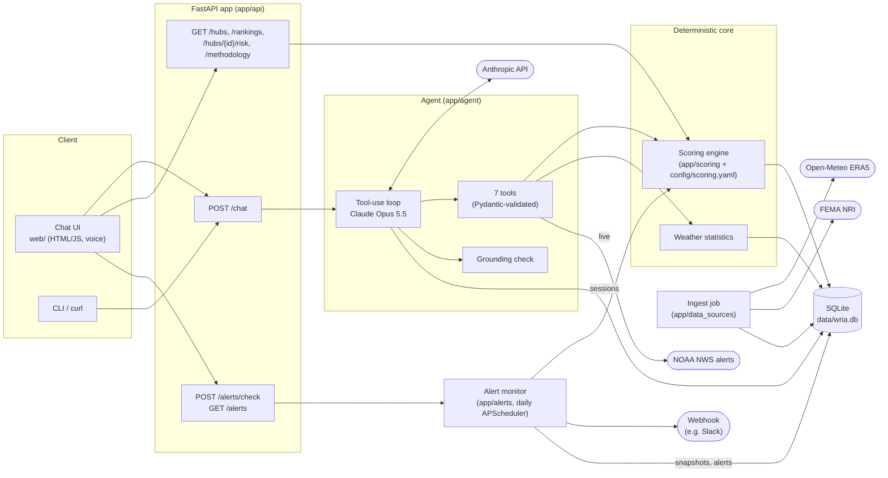

# Architecture

The Weather Risk Intelligence Agent answers analysts' questions about weather disruption risk
at the company's US distribution hubs. The core design rule: **code computes every number, and
the LLM only chooses which code to run and explains the results.**

## 1. System overview



### Request flow for one chat question

1. The UI sends `POST /chat {message, session_id}`.
2. The agent loads the conversation from SQLite and calls Claude with the system prompt, the
   history and 7 tool definitions. The JSON schemas of the tools come from Pydantic models.
3. Claude asks for tools (for example `rank_hubs(rank_by="winter", region="Midwest")`). Each
   tool input is validated by its Pydantic model, then runs deterministic Python. Errors such
   as an unknown hub go back to Claude as `is_error` results, so it can recover (for example by
   asking which Portland the user meant).
4. This repeats for up to 8 rounds. The last round has tools turned off, so a reply is
   guaranteed.
5. The final reply must follow the `AgentAnswer` JSON schema. The API enforces it
   (`output_config.format`) and Pydantic validates it again.
6. A **grounding check** compares every number in `key_figures` and `ranking` with the tool
   outputs, and every hub id with the hub registry. Anything unmatched is returned as
   `grounding_warnings`, which the UI shows.
7. The session is saved only after a valid answer. A failed turn never corrupts the
   conversation.

## 2. Components

| Component | Code | Responsibility |
|---|---|---|
| Data sources | `app/data_sources/` | HTTP clients for Open-Meteo, FEMA NRI and NWS, with retries and rate-limit waits. The ingest job is idempotent. |
| Storage | `app/storage/` | The SQLite schema and queries, and the builder of the starting database (`seed.py`). |
| Scoring engine | `app/scoring/` | Pure functions: weather metrics, then hazard scores, then a composite score, tier and rank. Weights and scales are in `config/scoring.yaml`. |
| Agent | `app/agent/` | The Claude tool loop, tool registry, output schema, system prompt and grounding check. |
| API | `app/api/main.py` | FastAPI endpoints, dependency injection (DB connection, agent) and static UI hosting. |
| Chat UI | `web/` | Plain HTML/CSS/JS with no build step. Ranking panel, follow-up chips, voice input and read-aloud. |
| Alerts | `app/alerts/` | Re-scores all hubs, compares the result with the last snapshot, and posts the changes to a webhook. Runs daily or on demand. |
| Evaluation | `evals/` | 17 cases graded by code, with expected values taken from the engine at run time. |

### The LLM ↔ code contract (JSON schemas)

There are two typed boundaries, both defined once in `app/agent/schemas.py`:

- **LLM → code (tool inputs).** Each tool's input schema is generated from a Pydantic model
  with `extra="forbid"`, and uses `Literal` types for hazards and regions. Invalid input is
  rejected before any code runs.
- **LLM → user (final answer).** `AgentAnswer` contains `answer`, `answer_type`, `hubs`,
  `ranking[]`, `key_figures[]` (each with `source_tool`), `reasoning`, `assumptions`,
  `data_sources`, `confidence`, `confidence_reason` and `follow_up_suggestions`. This makes
  assumptions and uncertainty a required part of every answer, not an optional extra.

### Scoring model (summary)

The full definition is in `config/scoring.yaml`, and the reasoning is in [PLAN.md](PLAN.md).

- **Five hazards:** winter (27%), flood (27%), hurricane and wind (26%), tornado and hail (15%),
  and heat (5%). Heat gets the lowest weight because it mostly slows work rather than closing
  a hub.
- **Hazard scores.** Each hazard score is a weighted mix of components from two sources:
  - ERA5 weather counts, such as snow days per year or heavy-rain days;
  - FEMA NRI annual frequencies.

  Each component is scaled to 0–100 on a **fixed** range, not min–max across hubs. Then one
  hub's score changes only when its own data changes, which keeps rankings stable and alerts
  meaningful.
- **Tiers:** High ≥ 60, Elevated ≥ 40, Moderate ≥ 20, Low below 20.
- **Fingerprint.** A hash of `scoring.yaml` is stored with each score snapshot, so you can
  always tell which model produced a number.

## 3. Repository structure

```
app/
  api/main.py         FastAPI app: chat, data, alert endpoints; serves web/
  agent/
    agent.py          Claude tool-use loop, sessions, CLI
    tools.py          7 tools wrapping the deterministic core + score cache
    schemas.py        Pydantic models: tool inputs + AgentAnswer output schema
    prompts.py        System prompt (rules: no invented numbers, scope, uncertainty)
    grounding.py      Checks answer numbers/hubs against tool outputs
  scoring/            engine.py, metrics.py, stats.py, models.py
  data_sources/       open_meteo.py, fema_nri.py, nws.py, http.py, ingest.py
  storage/            db.py (schema + queries), seed.py (starting database builder)
  alerts/             monitor.py (snapshot/diff/notify), scheduler.py (APScheduler)
  config.py           Settings (.env) and hub registry
config/
  hubs.yaml           21 hubs: id, region, coordinates, county FIPS
  scoring.yaml        Metrics, hazard weights, scales, tiers
data/seed/            Committed starting database (copied to data/wria.db on first start)
web/                  index.html, app.js, styles.css
evals/                cases.yaml, grader.py, run.py, baseline.md
tests/                Unit + API + eval-harness tests (offline, no API key needed)
docs/                 PLAN.md, ARCHITECTURE.md, ai-session/
Dockerfile, render.yaml
```

## 4. Data storage choice: SQLite

**Choice:** one SQLite file (`data/wria.db`) in WAL mode.

| Table | Contents |
|---|---|
| `weather_daily` | ~38k rows: one per hub per day for 2021–2025 (snowfall, precipitation, min/max temperature, gusts) |
| `nri_county` | FEMA NRI record per county (JSON) |
| `chat_sessions` | Full message list per session, so follow-ups keep their context |
| `score_snapshots`, `risk_alerts` | Alert history |
| `fetch_log` | What was fetched and when |

**Why SQLite**
- **Size.** The data is small (3.4 MB) and read-heavy, with essentially one writer (the
  ingest or alert job). A database server would add work to run and no benefit.
- **Fast, cheap reads.** Scoring reads a hub's 5 years of weather in milliseconds, and scores
  are cached in memory after that.
- **The data ships with the code.** The committed starting copy (`data/seed/wria-seed.db`)
  means a fresh clone or container works immediately. It doesn't depend on the free APIs'
  rate limits, and the numbers are reproducible for evaluation.
- **Concurrency.** WAL mode lets the API read while the alert job writes.

**Alternatives considered**
- *Postgres:* better for many writers or several app instances, but it adds a server to run.
- *Parquet/CSV files:* fine for the weather data, but awkward for sessions and alerts.
- *Fetching from the APIs on every question:* rejected because it's slow, rate-limited and
  not reproducible.

**When this would change.** Several server instances, or sessions that must survive
redeploys on a host with an ephemeral disk, would mean moving `chat_sessions`,
`score_snapshots` and `risk_alerts` to a hosted Postgres. The read-only weather and FEMA data
could stay as a file. All SQL lives in `app/storage/db.py`, so the change is contained there.

## 5. Deployment

- **Container:** `Dockerfile`, built on uv's Python 3.12 slim image.
  - Dependencies are installed from `uv.lock` (`--frozen`), so versions are pinned.
  - It runs as a non-root user with a health check on `/health`.
  - It runs **one worker on purpose:** the alert scheduler runs inside the process, and SQLite
    has one writer.
- **Host:** Render, using `render.yaml`. `ANTHROPIC_API_KEY` is set in the dashboard and never
  stored in git.
- **Free-tier limits:**
  - The service sleeps after about 15 minutes idle, and the daily alert job doesn't run while
    it's asleep. On a paid plan you'd use a Render cron job calling
    `python -m app.alerts.monitor`.
  - The disk is wiped on redeploy. Each deploy starts again from the starting database, so
    chat sessions and alert history are lost.
- **Scaling path:** a hosted database for state, and the alert job moved to an external
  scheduler so it runs once. After that the API is stateless and can have several replicas.

## 6. Reliability, cost and safety

- **LLM failures.** Server-side model fallback is enabled. Refusals, `max_tokens` cut-offs and
  invalid output raise an `AgentError`, which the API returns as HTTP 502. Each session has
  a lock, so two messages can't interleave.
- **Cost.**
  - Prompt caching covers the system prompt and tools.
  - `effort: medium` is used.
  - The data endpoints (`/rankings` and the others) never call the LLM.
  - An eval run costs about $1 for 17 cases.
- **Honesty.**
  - The prompt and schema require stated assumptions and a confidence level.
  - The grounding check catches invented numbers.
  - Eval cases test unknown hubs, off-topic questions, years with no data, and requests for
    dollar estimates.

## 7. Known limitations

- **Data resolution.** ERA5 is gridded (~25 km), so values are point estimates, not station
  observations. FEMA NRI is county-level and updated rarely.
- **Exposure only.** The score measures exposure to weather, not financial loss, because there
  is no hub throughput or cost data.
- **Judgment calls.** The weights and scales are documented and easy to change, but they are
  judgment calls, not values fitted to historical outages.
- **Live alerts aren't scored.** Live NWS alerts are shown as context only; they are not part
  of the score.
